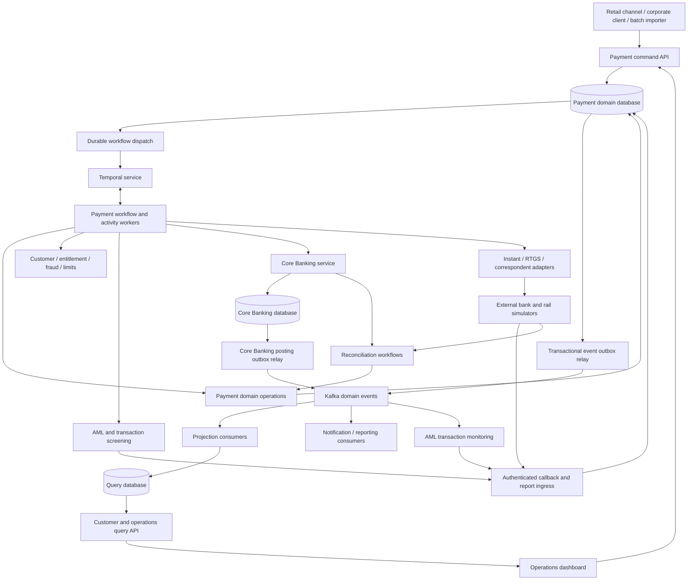
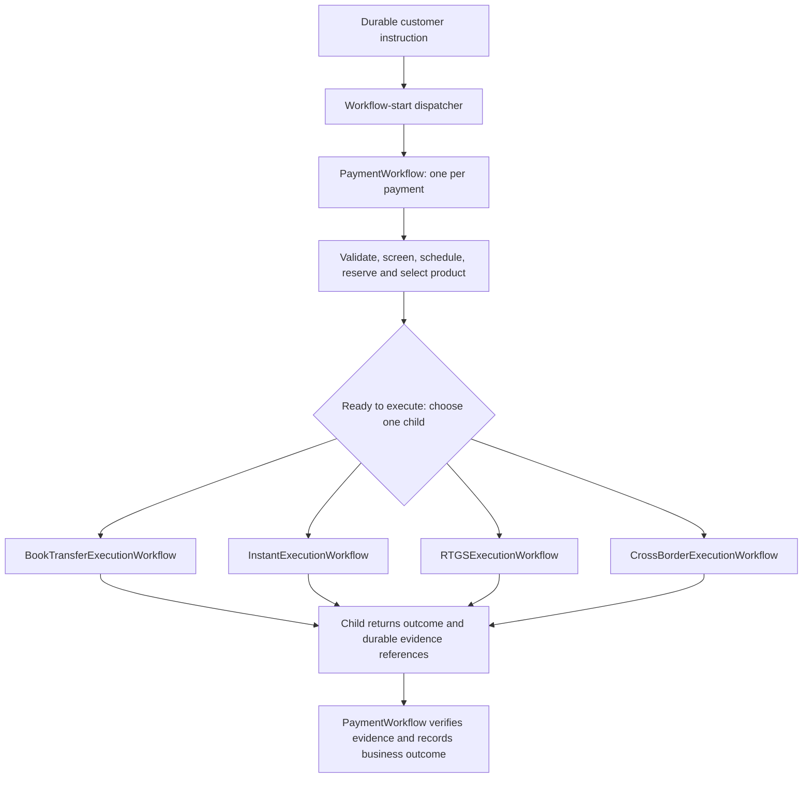
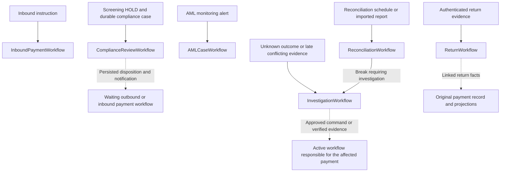

# GTB Payment Platform — Foundation and Implementation Plan

Status: proposed implementation plan. Date: 2026-09-26.

## 1. Purpose and intended result

Implement Global Trust Bank's payment platform as a runnable reference implementation of this repository's book. It will accept customer and corporate payment instructions, coordinate execution with Temporal, integrate with separately running banking and rail simulators, maintain separate CQRS command and query models, and provide an operations dashboard for investigation, approval, and reconciliation.

This document defines what to build and how to build it. Application implementation follows the phased plan linked below.

For phase order, current implementation status, and interruption recovery, start with the [implementation tracker](gtb-implementation.md). Each phase has a separate work packet so implementation sessions can load only the relevant scope.

The central design rule is that payment facts, accounting entries, external evidence, workflow progress, and customer views have distinct owners. A successful workflow or HTTP response alone never proves that a payment completed.

**Core Banking** is the service responsible for customer accounts, booked/available balances, reservations, debit/credit postings, and account statements in this plan. Its posting engine preserves double-entry accounting internally. Finance/general-ledger reporting is a separate downstream responsibility; the foundation implements only the Core Banking capabilities needed by payments, not an entire core banking product suite.

## 2. Assumptions, scope, and decisions to confirm

No application stack currently exists in this repository. The user confirmed Go + React and a local reference platform with simulators. The remaining technology choices below are proposed defaults:

| Area | Foundation decision |
| --- | --- |
| Backend | Go, standard-library HTTP services, Temporal Go SDK; one Go module with separate service binaries |
| Dashboard | React, TypeScript, Vite; accessible tables, forms, and timelines |
| Persistence | PostgreSQL; separately owned payment, Core Banking, simulator, and projection databases |
| Event transport | Kafka, with a single-node local development configuration |
| Runtime | Docker Compose; persistent local volumes; optional observability profile |
| Identity | Local OIDC provider with seeded customer and operator identities; service credentials |
| Initial products | Book transfer, domestic instant, RTGS, and cross-border account-to-account transfers |
| Currency scope | SGD first; USD for same-currency cross-border examples; no currency conversion in the foundation |
| Integrations | Executable simulators behind versioned interfaces, using synthetic accounts and money |
| Architecture | Modular payment application with separate API, worker, and projector processes; independent Core Banking and external simulator processes |

Select and pin a supported Go toolchain and compatible dependency/container versions during scaffolding. Use explicit SQL with generated query bindings where useful, keeping transactions visible in application code. Record deployment choices and dependency compatibility in architecture decision records.

The foundation includes authentication, domain controls, durable recovery, accounting invariants, and audit records, but is not certification for operating a real bank. Real scheme connectivity, legal finality, regulatory retention, real sanctions providers, HSM integration, production disaster recovery, and deployment infrastructure require institution-specific inputs.

No further clarification is needed to begin the local foundation. Before a subsequent production release, confirm the jurisdiction, real rail specifications, currencies, accounting policies, throughput, and availability objectives.

Rail timings and detailed rules below are fictional GTB simulator policies. Domestic instant uses FAST as a category example; RTGS uses MEPS+ as a category example. The simulators do not claim to implement or certify against FAST, MEPS+, SWIFT, or an ISO 20022 scheme profile.

## 3. Traceability to the book

| Book learning | Implementation consequence |
| --- | --- |
| [Chapters 1–2: instruction and lifecycle](../manuscript/02-the-payment-lifecycle.md) | Separate receipt, acceptance, execution, settlement, and completion evidence |
| [Chapters 3–4: participants and rails](../manuscript/04-payment-rails.md) | Explicit institutional boundaries and distinct rail policies/adapters |
| [Chapter 5: acceptance](../manuscript/05-can-the-bank-accept-this-payment.md) | Entitlement, account, fraud, AML/transaction screening, limit, funds, and routing decisions with evidence |
| [Chapter 6: accounting](../manuscript/06-where-is-the-money.md) | Independent Core Banking; atomic reservations and balanced immutable postings |
| [Chapter 7: state](../manuscript/07-payment-state.md) | Business, accounting, rail, workflow, and customer state remain separate |
| [Chapters 8–10: boundaries and retries](../manuscript/10-retrying-without-paying-twice.md) | Durable inbox/outbox, stable operation identities, explicit unknown outcomes |
| [Chapter 11: long-running processes](../manuscript/11-long-running-processes.md) | Temporal workflows, durable timers, callback handling, human review |
| [Chapter 12: facts and views](../manuscript/12-facts-events-and-views.md) | CQRS, domain event journal, independent rebuildable projections |
| [Chapters 13–14: reconciliation and exceptions](../manuscript/13-reconciliation.md) | Independent evidence matching, returns, cancellation, and repair cases |
| [Chapters 15–16: operations and architecture](../manuscript/16-designing-gtb-payment-platform.md) | Business dashboard, controlled commands, observability, recovery drills |

## 4. System boundaries and deployment shape



The command API and workers share domain modules and the payment database, using the same transition rules. This keeps the initial codebase manageable without allowing the dashboard, projectors, or simulators to mutate payment records. Each separately owned database has separate credentials; sharing one local PostgreSQL server does not permit cross-domain table writes or cross-service transactions. Temporal owns its own persistence.

### Systems included

| System | Direction / authority | Foundation implementation |
| --- | --- | --- |
| Retail/mobile channel simulator | Upstream customer instructions | Small submission screen or CLI; status and duplicate-request scenarios |
| Corporate/treasury client | Upstream higher-value and scheduled instructions | API examples with corporate entitlements and approval requirements |
| Batch importer | Upstream bulk instructions | Synthetic JSON/CSV fixture import; file hash and stable item identities; per-item results |
| Customer/KYC directory | Dependency; customer identity, account ownership, and risk profile | Synthetic customer due-diligence and risk fixtures; Core Banking owns current account status and balances |
| Entitlement and limits service | Dependency; permissions and reserved daily limits | Durable reservation/consume/release operations, scoped to customer and business date |
| Fraud risk service | Dependency; fraud decisions | Synthetic fraud rules; PASS, REJECT, REVIEW with decision evidence; separate from AML decisions |
| AML/transaction screening service | Dependency; pre-execution control decisions | Synthetic sanctions/watchlist, party/bank/country/reference screening and transaction rules; PASS, HOLD, REJECT, or ERROR |
| AML transaction monitoring service | Downstream facts, upstream alerts/cases | Stateful rolling-window rules for unusual activity; deduplicated events, restricted compliance cases and dispositions |
| Core Banking service | Downstream account and posting authority | Independent transactional implementation with account, balance, hold, posting, and statement APIs |
| Routing and business calendar | Payment-domain capability | Versioned eligibility, amount thresholds, availability, cut-offs, and holiday fixtures |
| Instant rail and recipient bank | Downstream execution, upstream evidence | Submission, stable-ID lookup, callbacks, credit outcomes, and settlement reports |
| RTGS settlement rail | Downstream execution, upstream evidence | Liquidity queue, operating windows, settlement acknowledgement and statements |
| Correspondent bank | Downstream execution, upstream evidence | Delayed acceptance, information requests, beneficiary confirmations, and nostro statements |
| Inbound rail gateway | Upstream external payments | One simplified inbound instant flow: validate, deduplicate, screen, credit GTB beneficiary |
| Notifications | Downstream consumer | Local delivery log/webhook sink with event deduplication; no real customer messages |
| Finance/reporting | Downstream consumer | Daily counts and totals by currency, settlement exposure, downloadable reports |
| Operations | Query consumer and command initiator | Dashboard, review queues, approvals, investigations, and reconciliation cases |

Simulators keep their own durable records and expose fault controls: delay, reject, duplicate, reorder, lose response after committing, omit callback, and publish a mismatched statement. They must create genuinely independent reconciliation evidence, rather than echoing GTB's payment rows.

## 5. Products, lifecycle, and financial invariants

### Product terminology

- **Book transfer:** a transfer between two accounts held at GTB, handled through Core Banking without an external payment rail. This is the scenario previously called on-us.
- **Domestic instant:** the payment category exemplified by Singapore's **FAST (Fast And Secure Transfers)**, which supports almost immediate SGD transfers between participating institutions. See [ABS: FAST](https://www.abs.org.sg/e-payments/fast).
- **RTGS (high-value payments):** the foundation's high-value route settles instructions individually on a gross basis in real time when eligible and funded. **MEPS+** is Singapore's RTGS system. High-value describes the product/use case; RTGS describes its settlement mechanism. See [MAS: MEPS+](https://www.mas.gov.sg/regulation/payments/meps).

FAST and MEPS+ illustrate the two external categories; neither reference imports real scheme cut-offs, limits, completion criteria, or message specifications into the simulator.

### Payment products and completion policies

| Product | Execution model | Evidence needed for GTB completion |
| --- | --- | --- |
| Book transfer | Reserve and atomically transfer between GTB accounts | Balanced Core Banking transfer posted to both accounts |
| Domestic instant | Reserve, book outbound obligation, submit, await evidence | Simulator settlement confirmation, beneficiary credit confirmation, and corresponding Core Banking postings |
| RTGS | Reserve, await execution window/liquidity, submit for settlement | Final settlement evidence under the fictional rail policy and Core Banking settlement postings |
| Cross-border | Screen, reserve, submit to correspondent, resolve information requests | Correspondent debit/settlement evidence, beneficiary credit confirmation, and Core Banking postings |
| Inbound instant | Authenticate instruction, screen beneficiary, establish settlement evidence | Single beneficiary credit funded by matching settlement accounting |

For RTGS payments the customer view says `Settled` when only interbank settlement is proven; it does not claim beneficiary credit. Every route records `completionScope` and `completionPolicyVersion`. All policies are executable domain rules with tests. An external transport acknowledgement is never sufficient completion evidence.

### Separate state dimensions

- **Business lifecycle:** `RECEIVED`, `VALIDATING`, `SCHEDULED`, `REQUIRES_REVIEW`, `ACCEPTED`, `EXECUTING`, `COMPLETED`, `REJECTED`, `CANCELLED`, `RETURNED`.
- **Execution outcome:** `NOT_SUBMITTED`, `PENDING`, `CONFIRMED_SUCCESS`, `CONFIRMED_FAILURE`, `UNKNOWN`.
- **Accounting facts:** hold references and status, original posting IDs, settlement posting IDs, and linked reversal/return posting IDs. A summary cannot replace these records.
- **External evidence:** original rail codes, message IDs, external transaction IDs, occurrence/receipt timestamps, and protected payload references.
- **Workflow progress:** current wait, next deadline, last activity result, workflow/run IDs; diagnostic only.
- **Screening/control state:** required checks, pending/held/cleared/rejected/error decisions, screening versions and expiry; AML monitoring case status is separate from payment completion.
- **Reconciliation/case state:** unmatched, matched, break open, under investigation, resolved; independent of original payment outcome.
- **Customer projection:** Processing, Needs information, Completed, Settled, Failed, Cancelled, or Returned according to explicit mapping rules.

`UNKNOWN` stays Processing and creates an investigation when its policy deadline expires. A rejected or cancelled customer outcome is published only after any required reservation release or evidenced compensation is resolved. Returns are linked financial processes; they preserve the original completion history.

### Non-negotiable invariants

1. Each logical instruction has one payment ID. Each financial operation has one durable operation ID.
2. Money uses integer minor units with validated currency scale and checked bounds; never binary floating point.
3. Every Core Banking transaction balances debits and credits within one currency. Posted entries are immutable.
4. Funds and limits are reserved atomically in their owning systems; concurrent acceptance cannot overspend. The foundation has no overdraft facility.
5. No completion without the product's required accounting and external evidence.
6. No blind resubmission, route switching, hold release, or compensating credit while an external effect remains unknown.
7. Each state transition records its evidence, actor/system, policy version, and aggregate version.
8. Read models may lag; they never authorize movement of money.
9. Manual changes use validated commands with audit records. No direct production-style SQL repair UI.
10. Original instructions and financial history remain inspectable after cancellation, reversal, return, or repair.

### Accounting model

Implement an independent Core Banking service with a transactional double-entry posting engine. Include customer deposit liability accounts, outgoing clearing payable accounts, settlement/nostro asset accounts, and suspense accounts for unresolved incoming funds. Seed balances through balanced opening journals.

The examples below are **separate scenarios with ordered steps inside each scenario**. They are not one sequence of postings that every payment executes. A successful outbound payment follows Scenario A; a rejected outbound payment follows the alternative in Scenario B. A later return is Scenario C. Book transfers and inbound payments are separate journeys in Scenarios D and E.

These are simplified GTB demonstration accounting rules, subject to GTB finance validation before real use. All amounts are SGD, with no fees, FX, overdraft, or unrelated account activity.

#### Reading the debit and credit columns

The entries are shown **from GTB's accounting perspective**. A customer deposit is money GTB owes its customer, so it is a liability for GTB. A settlement/nostro balance is money GTB holds at a settlement institution or correspondent, so it is an asset for GTB.

| Account | What it represents | A debit does this | A credit does this |
| --- | --- | --- | --- |
| Customer deposit liability | GTB's obligation to the account holder; reflected in the customer's booked balance | Decreases the customer's balance | Increases the customer's balance |
| Outgoing clearing payable | An outbound payment obligation awaiting settlement | Decreases the outstanding obligation | Increases the outstanding obligation |
| Settlement/nostro asset | GTB's funds at the external settlement institution/correspondent | Increases GTB's funds there | Decreases GTB's funds there |
| Incoming suspense liability | Received funds awaiting allocation or compliance disposition | Decreases unallocated funds | Increases unallocated funds |

Each posting row below contains one balanced Core Banking transaction: the debit and credit commit together. Rows saying **no posting** are workflow, evidence, or reservation steps. The customer is not debited again when GTB later settles with another institution.

#### Scenario A — Successful SGD 100 outbound payment

Maya has SGD 1,000 at GTB and sends SGD 100 to Daniel at another bank. Her **booked balance** reflects posted entries; her **available balance** also deducts active reservations. Assume she starts with no holds and GTB has enough settlement funds.

| Step | What happens | Core Banking debit | Core Banking credit | Maya: booked / available |
| --- | --- | --- | --- | --- |
| A0 | Instruction received; required checks pass | No posting | No posting | 1,000 / 1,000 |
| A1 | Reserve 100 so Maya cannot spend it elsewhere | No posting; create hold | No posting | 1,000 / 900 |
| A2 | Consume the hold and book the outbound customer debit atomically | Maya deposit liability 100 | Outgoing clearing payable 100 | 900 / 900 |
| A3 | Submit to the rail and receive processing acknowledgement | No posting | No posting | 900 / 900 |
| A4 | External evidence confirms settlement; record GTB's settlement movement | Outgoing clearing payable 100 | Settlement/nostro asset 100 | 900 / 900 |
| A5 | Required completion evidence is satisfied for the product | No additional posting | No additional posting | 900 / 900 |

At A2, GTB owes Maya 100 less and has recorded an outgoing obligation of 100. That does not yet prove external settlement. At A4, GTB's external settlement asset falls by 100 and the outgoing obligation is cleared. Across A2 and A4, Maya's balance decreases only once. Her available balance stays at 900 when the hold is consumed because the booked debit replaces the reservation.

Daniel's bank owns the posting to Daniel's account. GTB records its confirmation as external evidence where the product requires it. An RTGS settlement confirmation supports the `Settled` view; it does not by itself prove Daniel was credited. Settlement and beneficiary confirmations may arrive in either order, so A5 evaluates the required facts rather than relying on callback order.

#### Scenario B — Outbound payment definitively rejected before settlement

This is an **alternative ending to Scenario A**, not another step after its successful settlement. Choose the branch matching how far the payment progressed:

| Point of rejection | Required action | Debit | Credit | Maya's resulting booked / available |
| --- | --- | --- | --- | --- |
| Before A1 | Reject the instruction; no funds were held or posted | No posting | No posting | 1,000 / 1,000 |
| After A1, before A2 | Release the 100 hold | No posting | No posting | 1,000 / 1,000 |
| After A2, before A4, with definitive evidence that the external payment will not execute | Append a compensating transaction linked to A2 | Outgoing clearing payable 100 | Maya deposit liability 100 | 1,000 / 1,000 |

In the final branch, the compensation clears the outgoing obligation and restores Maya's booked balance; the original debit remains in history. These examples assume no separate compliance restriction requires retaining funds. A network timeout alone is not rejection evidence: if submission may have executed, retain the unresolved position and investigate instead of restoring Maya's funds automatically.

#### Scenario C — A settled outbound payment is later returned

This starts **after Scenario A has settled**. Maya's balance is 900 and the original outgoing clearing payable has already been cleared. Assume the other institution subsequently returns the full 100, the funds are confirmed received, and required controls permit crediting Maya.

| Step | What happens | Debit | Credit | Maya: booked / available |
| --- | --- | --- | --- | --- |
| C1 | Record the independently evidenced receipt of returned funds and credit Maya | Settlement/nostro asset 100 | Maya deposit liability 100 | 1,000 / 1,000 |

This is a new transaction with its own return ID, linked to the original payment. It does not delete A2 or A4, and does not use Scenario B's pre-settlement compensation. A return request or notification without confirmed funds is insufficient for C1. If received funds require review, use suspense until clearance, as in Scenario E.

#### Scenario D — SGD 100 book transfer within GTB

Maya and Daniel both bank with GTB. Maya starts at 1,000 and Daniel at 200, with no existing holds. After controls pass, reserve Maya's 100 as in A1. Then consume the hold and execute the following single atomic posting:

| What happens | Debit | Credit | Result |
| --- | --- | --- | --- |
| Transfer between GTB customer accounts | Maya deposit liability 100 | Daniel deposit liability 100 | Maya: 900; Daniel: 300, both booked and available |

GTB now owes Maya 100 less and Daniel 100 more. No external settlement asset moves and no outgoing clearing payable is needed. This single posting replaces the outbound A2–A4 path.

#### Scenario E — SGD 100 inbound payment to a GTB beneficiary

This is a separate incoming payment. Daniel banks with GTB and starts with 200. Once external receipt is confirmed, choose **one** path based on screening; do not execute both paths for the same receipt.

| Path / step | What happens | Debit | Credit | Daniel: booked / available |
| --- | --- | --- | --- | --- |
| E1 — Already cleared | Record received settlement funds and credit Daniel atomically | Settlement asset 100 | Daniel deposit liability 100 | 300 / 300 |
| E2a — Screening pending/held | Record received funds in suspense, without crediting Daniel | Settlement asset 100 | Incoming suspense liability 100 | 200 / 200 |
| E2b — Later clearance of E2a | Transfer the existing suspense amount to Daniel | Incoming suspense liability 100 | Daniel deposit liability 100 | 300 / 300 |

E1 is the direct path. E2a followed by E2b is the review path. E2b does not debit the settlement asset again because E2a already recorded receipt. If screening rejects the payment, E2b does not run; an authorized return/disposition process handles the funds held in suspense.

Reservations affect available balance, not booked balance. Hold consumption and associated posting commit atomically within Core Banking. Outbound holds cannot expire silently once execution has claimed them; expired unclaimed holds force revalidation. Long-scheduled instructions reserve close to execution, with controls rerun then. Limits also use stable reservations and explicit consumption/release policies; returns do not automatically restore daily limits.

The foundation supports full-amount returns in the original currency. FX, fees, partial returns, overdrafts, and a complete bank general ledger are deferred. Reversals reference the original journal and use separate operation IDs. A settled outbound payment can be refunded only through an evidenced return or separately authorized business process, never by simply reversing a timeout.

### AML and transaction screening

Implement three separate capabilities: fraud risk checks, pre-execution AML/transaction screening, and ongoing AML transaction monitoring. All use synthetic rules/data in the local platform; these are GTB demonstration policies, not a claim of regulatory compliance or production detection effectiveness.

**Pre-execution screening** applies to book transfers, domestic instant, RTGS, cross-border, and inbound payments, with product-specific required fields. Submit payer/payee identity references, relevant institutions and countries, amount/currency, purpose/reference, route, and customer risk/KYC references. Simulate sanctions/watchlist matches, restricted destinations, incomplete required data, and transaction risk rules. Preserve provider request/decision IDs, input hash, rules/list versions, decision time, validity period, and restricted match evidence.

| Result | Required payment behavior |
| --- | --- |
| `PASS` | Permit execution only while all required decisions remain valid for the exact instruction and route |
| `HOLD` | Enter `REQUIRES_REVIEW`; create a restricted compliance case; prevent outbound submission or spendable beneficiary credit |
| `REJECT` | Stop execution; record disposition and perform only permitted release/compensation actions |
| `ERROR` / timeout | Keep screening pending/error, retry within budget, then escalate; never interpret unavailability as clearance |

Initial screening precedes funds reservation where possible. Revalidate before the atomic execution/submission claim; schedule delays, expired decisions, material data changes, or invalidated policy/list versions trigger a new screening attempt. A reviewed false positive is cleared only by an authorized compliance decision tied to the original input hash and case version, with an independent checker. General operations cannot override compliance blocks. A confirmed prohibited match has no generic release action in the demo.

For inbound funds already settled externally, HOLD/ERROR records the receipt in Core Banking suspense and withholds spendable beneficiary credit. Clearance transfers the evidenced amount from suspense to the beneficiary exactly once; rejection follows an authorized return/disposition workflow. Do not assume that an inbound control result can roll back external settlement. Any policy-directed account/funds restriction is a separate audited Core Banking command, not an automatic side effect of a monitoring alert.

**Ongoing monitoring** consumes versioned payment and Core Banking posting facts, deduplicated by event/operation ID. Include demonstrable rolling-window velocity, repeated small transfers, and activity inconsistent with seeded customer profiles. Define event-time windows and late-event handling; a rule hit creates a stable alert and compliance case, not a conclusion that the customer committed a crime. Monitor completed payments without rewriting their settled outcome or automatically returning money. Core Banking supplies its own transactional posting outbox for account-activity monitoring and finance feeds; payment events alone do not represent all account activity.

Each monitoring rule identifies its authoritative input fact and correlation key so a payment event and its associated posting event do not count as two transactions. Alert identity includes rule version, subject, and evaluation window. Monitoring outages retain a durable backlog and expose freshness/coverage; catch-up cannot create duplicate cases or dispositions. Re-evaluation under a new rule version preserves the original results.

**Temporal integration:** screening activities use stable request IDs and queryable decisions. A `ComplianceReviewWorkflow` waits for authorized case disposition using durable inbox notifications and timers; the payment workflow awaits a valid decision. A separate `AMLCaseWorkflow` manages monitoring alerts, investigation, escalation, and closure even after payment execution ends. Screening expiry and escalation timers cannot release a payment automatically.

**Compliance dashboard:** separate screening holds and monitoring alerts; show restricted evidence, rules/list versions, decision freshness, assigned reviewer, age, deadlines, and approval history. Provide false-positive disposition, reject, request information, escalate, and submit/approve clearance actions. Customer-facing views show only suitable generic pending/status information. Compliance match details stay out of general events, customer notifications, and broadly accessible operations views.

**Simulator and acceptance cases:** clean pass; synthetic list match with false-positive clearance; confirmed-match rejection; unavailable provider; delayed/duplicate decision; expired clearance requiring rescreening; forbidden self-approval; inbound suspense pending clearance; and a post-completion monitoring alert with no duplicate financial effect. Reporting to authorities and production case-management integrations remain deferred; no real regulatory reports are sent.

## 6. Temporal orchestration

**`PaymentWorkflow` is the overarching workflow for one customer-initiated payment**, covering book transfer, domestic instant, RTGS, or cross-border. Once the instruction passes its controls and is ready to execute, it starts **one selected product execution child workflow** and waits for that child's result. It does not start every workflow listed below, and it is not one global workflow for the entire platform.

Inbound payments have their own entry workflow, `InboundPaymentWorkflow`. Compliance cases, AML investigations, returns, and reconciliation are independently started workflows because their lifetimes and triggers differ from the original payment. All five foundation products use Temporal; book transfer remains a short execution path.

### Parent and execution-child relationship



The validation/control and finalization boxes are steps inside `PaymentWorkflow`, not additional workflows. Its activities call the owning services. A payment rejected before execution starts no execution child. The four product branches are alternatives, not sequential stages or parallel attempts to send the same payment.

The parent owns common acceptance and final lifecycle decisions. The selected child owns the product's execution sequence: Core Banking posting operations, external submission where needed, waits for rail evidence, and product-specific recovery. The child records confirmed facts through domain activities and returns evidence references. The parent evaluates the completion policy; a child finishing successfully in Temporal is not itself proof that money settled.

### Workflows with independent lifetimes



Solid arrows in this second diagram show the trigger for starting an independent workflow **through durable dispatch**, not a Temporal parent/child relationship. Dashed arrows show durable decisions, commands, or evidence notifications. The original payment record can be updated by a validated return process even when its original workflow has closed; that process does not restart or repay the original instruction.

| Workflow | Relationship and starter | Responsibility / what waits for it |
| --- | --- | --- |
| `PaymentWorkflow` | Top-level; payment receipt dispatcher | Common outbound lifecycle; awaits the selected execution child and any required compliance disposition |
| `BookTransferExecutionWorkflow` | Child started by `PaymentWorkflow` | Atomic transfer and evidence recording; returns to its parent |
| `InstantExecutionWorkflow` | Child started by `PaymentWorkflow` | Submission, callback/status resolution, settlement and beneficiary evidence; returns to its parent |
| `RTGSExecutionWorkflow` | Child started by `PaymentWorkflow` | Cut-off calendars, liquidity waits, settlement confirmation; returns to its parent |
| `CrossBorderExecutionWorkflow` | Child started by `PaymentWorkflow` | Correspondent submission, information requests, delayed confirmations; returns to its parent |
| `InboundPaymentWorkflow` | Top-level; authenticated inbound receipt dispatcher | Inbound deduplication, controls, suspense if required, and settlement-backed beneficiary credit; no `PaymentWorkflow` parent |
| `ComplianceReviewWorkflow` | Independent; case dispatcher after a screening HOLD | Reviewer/checker disposition, expiry, and revalidation; the requesting payment workflow waits for valid clearance or rejection |
| `AMLCaseWorkflow` | Independent; monitoring-alert dispatcher | Restricted investigation and disposition; a completed payment does not wait for this later monitoring case |
| `ReturnWorkflow` | Independent; authenticated return-evidence dispatcher | Validate return evidence and perform one linked return posting; may run after the original workflow closes |
| `InvestigationWorkflow` | Independent; case dispatcher for unknown outcomes, conflicts, or reconciliation breaks | Obtain evidence and coordinate approved resolution; an active execution workflow may wait for its result |
| `ReconciliationWorkflow` | Independent; schedule or report-import dispatcher | Match independent records/totals and create break cases; does not start ordinary payment execution children |

A workflow creates an independent case by calling an activity that atomically persists the case and its dispatch record. The dispatcher starts the case workflow with a stable ID. This is deliberately different from calling Temporal's child-workflow API. Duplicate triggers rediscover the existing case.

### Example: a cross-border payment with a screening hold

1. The receipt dispatcher starts `PaymentWorkflow` for Maya's instruction.
2. A screening activity returns HOLD. The parent persists a compliance case and waits; no execution child has started and no external instruction is sent.
3. The case dispatcher starts `ComplianceReviewWorkflow`. Authorized reviewers record a disposition, which is persisted and delivered back through the durable inbox/notification path.
4. After valid clearance and the remaining acceptance checks, `PaymentWorkflow` starts `CrossBorderExecutionWorkflow` as its child and awaits its result.
5. The child coordinates Core Banking and the correspondent adapter, waits for the required external evidence, and returns the recorded outcome/evidence references. The parent verifies these and records completion.
6. If the funds later return, return ingress starts a separate `ReturnWorkflow`. If monitoring later raises an alert, its dispatcher starts an `AMLCaseWorkflow`. Neither requires the original parent to remain open.

### Execution ownership, identifiers, and closure

Use `workflow.ExecuteChildWorkflow` with an explicit child ID and await its result. This establishes an actual Temporal parent/child relationship, as described in the [Go child-workflow documentation](https://docs.temporal.io/develop/go/workflows/child-workflows).

Workflow IDs are stable: `payment/{paymentId}`, `inbound/{rail}/{externalTransactionId}`, `execution/{paymentId}/{product}`, `compliance/{caseId}`, `aml/{caseId}`, `investigation/{caseId}`, `return/{rail}/{returnId}`, and `recon/{source}/{businessDate}/{reportVersion}`. Temporal run IDs are diagnostic and never Core Banking idempotency keys.

Persist the active execution-workflow ID with the payment. Route rail callbacks and execution commands to that child, compliance dispositions to the workflow awaiting screening, and return evidence to the independent return process. Every receiver rechecks durable records and versions. Parent, child, and case workflows cannot each independently submit the same financial operation; investigation supplies evidence or approved commands to the current execution owner. After closure, a separately authorized resolution workflow handles remaining work without restarting the original execution.

Configure execution children with `ParentClosePolicy=ABANDON` so unexpected parent closure does not automatically terminate potentially unresolved financial execution. This policy leaves the child running; it is not a financial cancellation or rollback. The normal path still waits for the child before the parent completes. See [Temporal Parent Close Policy](https://docs.temporal.io/parent-close-policy).

An unexpectedly closed parent with a live child opens a recovery case. The child continues to persist evidence; recovery inspects that existing execution and finalizes the payment through version-checked domain operations, without starting another execution child. Unknown outcomes remain explicit while investigation proceeds. Business cancellation always follows the domain's submission/settlement rules rather than relying on parent termination.

Activities perform all database/network I/O. Workflow code uses Temporal's deterministic clock, timers, and concurrency APIs rather than native goroutines, ordinary channels, or wall-clock calls. Decisions depending on calendars, configuration, or external state are obtained through activities and retained with their versions. See the official [Go SDK guide](https://docs.temporal.io/develop/go).

### Receipt, start, and completion sequence

1. Authenticate the caller and validate request syntax. In one payment-database transaction, persist the instruction, idempotency record, `PaymentReceived` fact/event, and workflow-start dispatch row.
2. Return HTTP `202` with payment ID and receipt version. This means durably received, not accepted or completed. A Temporal outage leaves dispatch pending and visible.
3. A leased dispatcher starts the stable workflow ID. Start retries rediscover the existing execution. Configure duplicate-start rejection; also check durable lifecycle/dispatch records so expired Temporal history never causes a completed payment to execute again.
4. The workflow loads immutable instruction data, obtains fraud and AML/transaction-screening decisions, waits for scheduling/compliance review if needed, reserves limits and funds, and records acceptance. Required clearance is revalidated at the execution claim. Failed partial reservations are released idempotently unless a separately authorized restriction applies. Unresolved releases remain tracked cases.
5. Execute the chosen product. Before every external side effect, persist the operation identity and intended request. Record confirmed effects through the domain module with optimistic concurrency and deduplication.
6. Record completion only after evaluating its evidence policy; atomically append the domain event, audit entry, and event outbox row with the state change.

### Callbacks and operator commands

Callback ingress authenticates the sender, validates correlation and payload schema, and commits raw evidence plus an inbox row before acknowledgement. A dispatcher signals the workflow with an evidence reference. Signals are notifications to consume durable inbox records; receipt by Temporal is not proof the business command ran. This follows Temporal's [Go message-passing semantics](https://docs.temporal.io/develop/go/workflows/message-passing).

Inbox rows remain pending until domain processing is durably acknowledged. Duplicate or out-of-order messages cannot regress facts. Invalid transitions, contradictory evidence, and unknown references create quarantined cases. Callbacks arriving before workflow start remain queued; callbacks arriving after closure are classified as duplicates, return evidence, or late-evidence investigations. They are never discarded solely because the workflow closed.

Operator actions similarly create durable command records and dispatch notifications. Go workflow signal channels carry references; the main workflow loop consumes them through a Temporal selector and processes commands serially. Domain operations use expected versions to arbitrate races among cancellation, submission, callbacks, and approvals. Approval captures the command payload hash and version; changed facts invalidate stale approval.

The submission boundary is an explicit atomic claim. A cancellation wins only before that claim; after it, the platform must establish the rail outcome or follow an available recall process. Cancelling a Temporal execution is not a business cancellation and is not exposed to operators.

### Retry and deployment policy

- Classify validation/control rejections as business outcomes, transient dependency faults as retryable, and ambiguous external submissions as `UNKNOWN`.
- Set activity execution and overall retry deadlines explicitly, with exponential backoff and capped attempts. Business deadlines use durable timers. Exhausting a retry budget opens a case; it does not establish financial failure.
- Separate workflow, Core Banking/control, and per-rail activity task queues to contain overload. Apply per-dependency concurrency limits and circuit breakers.
- Retry financial writes only with stable operation IDs and a supported idempotency contract. After a lost reply, query by that ID. A rail without safe duplicate suppression gets no automatic submission retry after possible transmission.
- Use bounded history: reconciliation runs are chunked; long-lived investigations use Continue-As-New with durable case references and pending-command recovery. Drain signal channels and finish active handlers before rollover, as described in [Temporal Go message passing](https://docs.temporal.io/develop/go/workflows/message-passing).
- Add workflow-history replay checks before deployments; choose compatible worker deployment/versioning configuration for the pinned server and SDK. Preserve workers needed by in-flight workflows. See [Temporal Worker Versioning](https://docs.temporal.io/worker-versioning).
- Keep account details and raw messages outside workflow histories; pass IDs and minimal metadata. Restrict Temporal UI access and configure payload protection before handling sensitive deployments.

## 7. CQRS, events, and consistency

CQRS means separate write and read contracts, schemas, credentials, and processing paths. The foundation is **not full event sourcing**: current payment aggregates and associated evidence in PostgreSQL are authoritative business records; an append-only domain event journal supports integration and projection rebuilds. Temporal history and Kafka are not the financial system of record.

### Command model

Core records: `payments`, `payment_instructions`, `control_decisions`, `route_decisions`, `financial_operations`, `external_instructions`, `external_evidence`, `commands`, `approvals`, `investigations`, `returns`, `reconciliation_runs`, `reconciliation_breaks`, `audit_entries`, `idempotency_records`, `inbox`, `workflow_dispatch`, `domain_events`, and `outbox`.

Add `screening_requests`, `screening_decisions`, `compliance_cases`, and `compliance_dispositions` with restricted access. The monitoring service owns its rolling-window state, consumer checkpoints, and `aml_alerts`; it delivers alerts through authenticated, idempotent case ingress. Core Banking owns its posting event journal/outbox. These owners expose interfaces rather than sharing writable tables.

Use unique constraints for all logical identities, optimistic aggregate versions for transitions, and short local transactions. Each domain transition atomically changes the aggregate and appends evidence references, audit data, domain events, and event outbox entries. Payment-to-Core Banking consistency uses idempotent remote operations and recovery; it never assumes a transaction across both databases.

### Event publication

The outbox relay publishes at least once, marks delivery only after broker acknowledgement, and retries safely after crashes. Events are partitioned by aggregate ID. Per-aggregate versions detect duplicates and gaps even if relay workers or transport reorder delivery. Workflow dispatch records and business event publication have separate delivery state.

An event envelope includes `eventId`, `eventType`, `schemaVersion`, `aggregateType`, `aggregateId`, `aggregateVersion`, `occurredAt`, `recordedAt`, `correlationId`, `causationId`, `source`, and a minimal payload. Where multiple events arise in one transition, allocate a distinct ordered event sequence. Avoid unnecessary personal information.

Initial events include `PaymentReceived`, `PaymentReviewRequired`, `PaymentAccepted`, `FundsReserved`, `CustomerDebitPosted`, `ExternalInstructionSubmitted`, `ExternalOutcomeUnknown`, `ExternalPaymentAccepted`, `SettlementConfirmed`, `BeneficiaryCreditConfirmed`, `PaymentCompleted`, `PaymentRejected`, `PaymentCancelled`, `PaymentReturned`, and `ReconciliationBreakOpened/Resolved`.

Add minimal `ScreeningRequested`, `ScreeningHeld`, `ScreeningCleared`, and `ScreeningRejected` notifications. Keep `AMLAlertRaised` and `ComplianceCaseDispositioned` on restricted topics/consumers. Detailed match evidence is fetched only through authorized compliance APIs. Core Banking emits its own `CoreBankingPostingCommitted` event with stable operation/posting references.

Posting-related payment events reference confirmed Core Banking evidence; they do not create an alternative accounting authority. Raw rail statuses retain their original meaning alongside normalized facts.

### Query models

| Projection | Query purpose |
| --- | --- |
| `payment_summary` | Customer and operator search, lifecycle, amount, currency, route, age |
| `payment_timeline` | Ordered facts, control decisions, messages, accounting references, actions |
| `ops_work_queue` | Review, unknown outcome, overdue, liquidity, repair, and return cases |
| `reconciliation_summary` | Source/date totals, unmatched items, discrepancy reasons, case state |
| `business_metrics` | Received/accepted/completed counts, throughput, outcome age by rail |
| `customer_payment_status` | Scoped customer-facing interpretation without operator-only evidence |
| `notification_delivery` | Delivery attempts and failures independent of payment completion |
| `compliance_work_queue` | Restricted screening holds, AML alerts, assignment, deadlines, and disposition history |

Every consumer commits event deduplication, projection changes, and its checkpoint atomically in its own database before acknowledging consumption. Ordering gaps trigger bounded buffering and journal catch-up; poison messages enter a repair queue with visible lag. Cross-aggregate ordering is not assumed.

Retain the canonical domain event journal independently of Kafka and outbox cleanup. Rebuild into shadow projection tables from a consistent journal snapshot/watermark, catch up concurrent events, verify counts and representative timelines, then switch reads atomically. Rebuilding projections never replays financial activities or notifications. Schema changes use versioned consumers and event upcasters where needed.

Queries return `asOf`, projected aggregate version, and freshness indicators. Commands return `commandId`/`paymentId` and committed version. The UI displays Pending until that version is visible, with bounded polling. Command status is available from the command store even when projections lag; after submission, an unprojected payment returns a pending receipt rather than a misleading unknown ID.

### Identity and retention

| Boundary | Durable duplicate identity |
| --- | --- |
| Customer API | Channel + authenticated customer + idempotency key; canonical payload hash detects conflicting reuse |
| Corporate batch | Client + file identity/content hash + stable item ID |
| Workflow start | Stable payment workflow ID plus persistent dispatch record |
| Core Banking/limits | Payment ID + operation type + logical operation sequence |
| Outbound rail | Persisted rail instruction ID; reused on every permitted retry |
| Inbound messages | Sender/rail + external message ID, plus business transaction correlation |
| Return credit | Rail + return transaction ID, linked to original payment |
| Events / operator actions | Event ID / command ID plus consumer or actor scope |
| Screening / monitoring | Screening request ID + input/policy version; alert rule version + subject + window |

Same request identity and same payload return the original receipt; conflicting payload reuse returns `409`. Financial duplicate identities have no automatic TTL in the foundation. A production archive policy must preserve deduplication tombstones across API, replay, return, and recovery horizons.

## 8. API and adapter contracts

Define OpenAPI for synchronous boundaries and versioned JSON schemas for events and simulator messages. APIs use authenticated account/customer scope, bounded pagination, explicit error codes, and correlation IDs.

| Interface | Initial operations |
| --- | --- |
| Payment commands | `POST /api/v1/payments`, `POST /api/v1/payment-batches` |
| Payment actions | `POST /api/v1/payments/{id}/cancel-requests`, `POST /api/v1/payments/{id}/information-responses` |
| Operations commands | `POST /api/v1/cases/{id}/actions`, `POST /api/v1/commands/{id}/approvals` |
| Payment queries | `GET /api/v1/payments`, `GET /api/v1/payments/{id}`, `GET /api/v1/payments/{id}/timeline` |
| Command receipts | `GET /api/v1/commands/{id}` |
| Operations queries | `GET /api/v1/ops/queues`, `/metrics`, `/reconciliation/runs`, `/reconciliation/breaks` |
| Integration ingress | `POST /integrations/v1/{rail}/messages`, `POST /integrations/v1/{source}/reports` |
| Compliance ingress | `POST /integrations/v1/screening/decisions`, `POST /integrations/v1/aml/alerts` |
| Compliance operations | `GET /api/v1/compliance/cases`, `POST /api/v1/compliance/cases/{id}/dispositions`; clearance uses the approval contract |
| Screening port | Submit/inspect screening request and versioned decision; authenticated asynchronous callback |
| Core Banking port | Reserve, inspect/release hold, post balanced transaction, inspect operation, export statement |
| Rail port | Submit instruction, query outcome, ingest evidence, retrieve report; recall only where supported |

Each rail advertises capabilities: submission deduplication, authoritative status lookup, callback behavior, recall support, and required completion evidence. HTTP status codes alone cannot establish payment business outcomes. Integration contracts specify timeout behavior, ambiguous results, identity retention, authentication, and retriable errors.

## 9. Operations dashboard

Build a business operations application, with Temporal UI linked as an engineering diagnostic tool.

1. **Overview:** volumes by rail and currency, completion latency, oldest pending items, unknown outcomes, control holds, reconciliation breaks, dependency status, and projection freshness. Never sum monetary totals across currencies.
2. **Payment explorer:** search by GTB ID, customer reference, external ID, Core Banking posting, route, date, amount/currency, and state; paginated results and controlled export.
3. **Payment detail:** original instruction, separate state dimensions, completion scope, controls/routing explanation, accounting references, external evidence, unified timeline, workflow link, and allowed actions.
4. **Work queues:** compliance review, information requests, uncertain outcomes, liquidity/cut-off waits, aging cases, and failed integration delivery; assignment, reason, and deadline.
5. **Reconciliation:** runs and source completeness, totals, matched/unmatched records, break evidence, resolution commands, and recheck results.
6. **Approvals and audit:** maker/checker inbox, action payload, reason, evidence, actor history, and approval expiry.
7. **Demo scenarios:** development-only fault controls and scenario progress; disabled outside the local demo profile.
8. **AML and screening:** restricted hold/alert queues, match and rule evidence, screening freshness, monitoring coverage, compliance maker/checker actions, and full disposition history.

Roles: customer, ops viewer, investigator/maker, approver/checker, compliance reviewer, compliance approver, auditor, and platform administrator. Scope permissions by customer/team and action. High-impact release, reversal, or financial repair commands require a different eligible approver; compliance clearance specifically requires an eligible compliance approver. Authorization is checked server-side again when the command executes, not only when the button is shown.

Safe actions include request current rail status, attach evidence, supply requested information, approve/reject a review, request pre-submission cancellation, and propose an evidenced corrective posting. Financial repairs use typed Core Banking operations, prerequisite checks, and independent approval. The UI offers no arbitrary balance change, force-complete, or generic retry-payment button.

Use polling initially, with visible timestamps and pending command state; server-sent updates can follow if justified. Provide keyboard navigation, readable status text beyond color, masked personal details, and useful loading/error/empty states.

## 10. Reconciliation and exception handling

Run continuous internal checks on a configurable schedule and report-driven external checks per simulated settlement cycle/business date. Missing or incomplete reports are visible control failures, not zero-transaction successful runs.

| Comparison | Matching and control |
| --- | --- |
| Payment vs Core Banking | Payment/operation ID, amount, currency, expected journals and holds |
| Outbound instructions vs rail transactions | Rail transaction ID, message ID, direction, amount, currency |
| Rail settlement vs internal clearing | Settlement reference, value date, currency totals and item counts |
| Core Banking nostro records vs correspondent statement | Account, external reference, value date, debit/credit, opening/closing balances |
| Inbound instructions vs beneficiary credits | External transaction ID and unique credit operation ID |

Persist raw source files/messages, content hashes, source identity, parser version, import checkpoints, and report completeness markers. Import is idempotent. Corrected reports are new versions, preserving old evidence. Exact reference matches come first; ambiguous fallback matches are proposed to operators, never silently accepted on amount alone.

Detect missing internal/external records, unexpected duplicates, amount/currency mismatches, incomplete settlements, orphan holds, and completion without accounting evidence. Apply rail-specific timing tolerances before declaring an overdue mismatch. Group totals by currency, source, account, and business date.

A break opens one durable case with evidence, owner, deadline, and permitted resolutions. Only a subsequent comparison proving agreement can mark a financial break resolved. Operator acknowledgement does not make it financially reconciled. Contradictory late success after a recorded rejection enters investigation without automatically crediting or debiting the customer again.

## 11. Reliability, security, and observability

The failure behavior is part of the implementation contract:

| Failure | Required response |
| --- | --- |
| API commits; workflow start fails | Durable dispatch retries; receipt remains queryable |
| Core Banking commits; reply is lost | Inspect operation by stable ID; never post a second journal |
| Rail executes; response/callback lost | Preserve unknown outcome; query/reconcile; do not refund or reroute |
| Worker crashes during a wait | Resume from durable workflow history and domain evidence |
| Payment commit succeeds; Kafka unavailable | Outbox retains events; projection lag becomes visible |
| Consumer commits; acknowledgement lost | Redelivery is deduplicated atomically |
| Approval/cancel races with submission | Expected version and submission claim choose a valid outcome |
| Notification fails | Retry notification independently; payment outcome remains established |
| Screening provider unavailable | Prevent execution/beneficiary credit pending clearance; bounded retry and compliance escalation |
| Monitoring consumer unavailable | Retain backlog, alert on coverage lag, catch up without duplicate cases |
| Restore reintroduces pending work | Verify external operation identities and reconcile before financial dispatch resumes |

Use OIDC authentication, least-privilege roles, service identities, authenticated callbacks with replay controls, environment-managed secrets, audit access controls, and redacted telemetry. Store raw messages separately with restricted access. Audit is append-only for application roles; stronger tamper-evident archival is a production extension. Retention is configurable and requires jurisdiction-specific policy before real deployment.

Instrument APIs, activities, adapters, outbox/inbox dispatchers, and projectors with OpenTelemetry. Include payment, command, workflow, operation, and external IDs in structured correlation fields. Do not make high-cardinality payment IDs metric labels.

Track business outcome latency by product, unknown-outcome age, held funds, queue age, reconciliation coverage, dispatch backlog, worker capacity, activity failures, projection lag, and notification failures. Use bounded retries, bounded ingestion/concurrency, and per-rail circuit breakers. Reject overload before accepting a receipt when durable capacity cannot be assured.

Initial benchmark objectives, not production promises: sustain 20 payment receipts/second for 10 minutes with 100 concurrent payments on a documented local machine; p95 durable receipt under 500 ms; p95 projection freshness under 2 seconds in healthy conditions; worker restart recovery within 60 seconds. Measure results and identify hardware/configuration. Financial invariants must hold regardless of whether latency goals are met. Production availability, RPO, and RTO remain explicit design inputs.

Provide runbooks for unknown outcomes, unavailable Core Banking/rail, projection rebuild, workflow upgrade, failed reports, and local backup/restore. Recovery drills verify Core Banking integrity and external reconciliation, not just healthy containers.

## 12. Repository organization and implementation method

Preserve the manuscript. Add application code and executable contracts alongside it:

```text
spec/gtb-foundation.md
spec/gtb-implementation.md
spec/phases/
spec/adr/
backend/
  go.mod
  cmd/
    payment-api/
    query-api/
    payment-worker/
    event-projector/
    core-banking-service/
    bank-simulator/
    rail-simulator/
    screening-simulator/
    aml-monitor/
  internal/
    payment/domain/
    payment/application/
    payment/storage/
    workflows/
    adapters/
    projections/
    reconciliation/
    corebanking/
    compliance/
    amlmonitoring/
    simulators/
  migrations/
frontend/ops-dashboard/
contracts/openapi/
contracts/events/
infra/compose/
infra/observability/
fixtures/accounts/
fixtures/rails/
scenarios/
tests/acceptance/
docs/runbooks/
```

Use database migrations, small Go interfaces around domain ownership, and explicit domain transition functions. Enforce package dependency direction so domain packages do not import Temporal or transport code. Shared packages contain types and rules; they do not provide cross-service database access. Simulator ports make real adapters replaceable without changing workflow business rules. CI runs formatting, vetting, unit/integration tests, and the race detector where applicable.

Establish repeatable entry points for starting infrastructure, migrating/seeding data, running application processes, executing a named scenario, running verification, and stopping services. Normal startup preserves data. Destructive demo reset must be a separate explicit command.

## 13. Implementation phases and progress tracking

The executable delivery order and current status are maintained in [GTB implementation phases](gtb-implementation.md). That tracker replaces the earlier M0–M7 milestone sequence and links to one bounded work packet per phase in `spec/phases/`.

Implementation proceeds through infrastructure setup, backend capabilities, frontend capabilities, and integrated recovery/acceptance checks. Backend phases remain independently demonstrable through API/CLI scenarios before the frontend exists. Each frontend phase consumes an already validated backend contract. Phase dependencies, rather than the full architecture document, define the next coding session's scope.

At implementation start, mark the selected phase `in progress` in the tracker. Update its checkpoint during work and before pausing. Mark it `completed` only when its exit criteria pass and validation evidence is recorded; incomplete or failing checks keep it open. Record blockers explicitly. A resumed session first reads the tracker and the active phase packet, then only the referenced specification sections and relevant code.

The tracker is the single source of phase status; this architecture document remains the source of business and design requirements. Planning completion does not mean any implementation phase is complete.

## 14. Verification and definition of done

Use Go unit tests for policy/transition rules, Core Banking concurrency/property tests for balanced postings and funds safety, integration tests with PostgreSQL/Kafka, Temporal workflow tests with time skipping, adapter contract tests, and Playwright tests for operator journeys. Use Temporal's [Go testing tools](https://docs.temporal.io/develop/go/best-practices/testing-suite) for workflow time control and history replay.

Required end-to-end scenarios:

1. Book transfer success; same request repeated returns one payment; conflicting idempotency reuse is rejected.
2. Concurrent payments exceed available funds or daily limits; only permissible reservations succeed.
3. Core Banking commits before a worker crash/lost response; recovery discovers exactly one financial effect.
4. API receipt is committed during a Temporal outage; processing resumes when dispatch recovers.
5. External instant success with duplicated and reordered callbacks; evidence remains coherent.
6. External submission times out after remote execution; no resend/new route/refund without evidence.
7. Definitive rejection releases/reverses the permitted effects exactly once.
8. Review requires an eligible different approver; self-approval and stale approval are rejected.
9. Cancellation races with submission; the claim boundary prevents contradictory financial effects.
10. RTGS cut-off/liquidity and cross-border information waits survive worker restarts.
11. Late full return after workflow closure credits once and links to the original settled payment.
12. Missing report, amount mismatch, duplicate statement row, and missing posting produce distinct breaks.
13. Broker/projector outage shows stale views; replay and shadow rebuild produce equivalent queries without sending money or notifications again.
14. Duplicate inbound instructions and batch files produce one effect per logical instruction.
15. Unauthorized account access and operator actions are denied at the API and execution boundaries.
16. Local backup/restore and workflow upgrade preserve deduplication and pass reconciliation/replay checks.
17. All product routes enforce required screening; provider timeout, stale PASS, duplicate decisions, and an unauthorized clearance cannot bypass the execution gate.
18. A synthetic screening match is held, reviewed, and independently cleared or rejected; changes to instruction/policy invalidate stale approvals.
19. Settled inbound funds remain in Core Banking suspense during review; clearance credits once, and rejection preserves settlement evidence for disposition.
20. Rolling-window AML monitoring raises one correlated case across duplicate/payment/posting events, survives consumer restart, and leaves completed payment facts intact; unauthorized users cannot read match evidence.

Foundation completion means all scoped products and integrations run locally, the dashboard supports the stated journeys, all required scenarios pass, data survives ordinary restart, accounting totals reconcile, projection rebuild is demonstrated, and setup/recovery instructions work from a clean checkout. Benchmark outcomes and remaining production gaps are recorded honestly.

## 15. Deferred extensions

After the foundation, prioritize real rail adapters and scheme certification; finance-approved production accounting; FX and fees; partial returns and richer recall processes; corporate file formats and real ISO 20022 profiles; multi-entity banking; production identity and key management; multi-region recovery; and scaling based on measured load.

Those extensions must preserve the foundation's ownership, evidence, idempotency, and reconciliation rules. Replacing a simulator must not require redefining what GTB means by accepted, settled, or completed.
