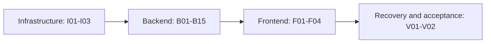

# GTB implementation phases and progress tracker

This is the execution/resume entry point for the [GTB foundation](gtb-foundation.md). The foundation owns architecture and business requirements; this document owns phase order and status; each linked packet owns its scope, exit criteria and execution checkpoint.

Planning is complete for this breakdown. **Application implementation is in progress.** Phase completion requires implementation and recorded validation.

## Resume pointer

- Active phase: none; I03 is complete.
- Next phase: **B01 — Core Banking accounts and posting engine**.
- Next action: read the B01 packet and required foundation sections, inspect the I03 handoff, and start its first bounded scope item with the dependency plan recorded below.
- Last completed phase: **I03 — Authentication and service runtime**.
- Blockers: none recorded.
- Last updated: 2026-09-26 — I03 completed again after replacing custom JWT/JWKS and UUID mechanics with maintained libraries, auditing planned dependencies across the design, and passing final unit/race/live/infrastructure/security checks.

Update these fields whenever the active phase changes or work pauses. If a phase is already active, resume its checkpoint instead of starting the next row.

## Dependency order

Infrastructure establishes runnable dependencies and identity. Backend phases deliver tested APIs, workflows, simulators and projections in small increments. Frontend phases consume those validated interfaces. Final verification exercises the integrated platform and recovery from a clean checkout.

The table order is the default serial schedule. The dependency column contains immediate prerequisites; prerequisites are transitive. B08 and B09 share B07 as a prerequisite, and B10 joins both. This allows separate sessions without implying concurrent agents. Do not start dependent work until prerequisites are completed or a documented scope/dependency change explains why it is safe.

Backend phases must be demonstrable with tests and API/CLI fixtures before the frontend exists. Authentication, financial invariants and failure tests are delivered with their owning feature, not deferred wholesale to final verification. If a packet grows too large for one session, checkpoint it and resume; optionally split it into stable subphase IDs and update this tracker before expanding scope.

## Dependency adoption register

Prefer a maintained, focused library for protocol parsing, cryptography, database
drivers, broker/workflow clients, telemetry and generated boundary code. Keep GTB
code for business rules, authorization policy, financial ambiguity handling and
small standard-library composition. A future phase must confirm compatibility and
pin the then-current exact version when it first imports a planned dependency; a
name in this table is a design decision, not permission to add an unused module.
See [ADR 0007](adr/0007-maintained-libraries-and-project-owned-code.md) for the
review criteria, alternatives and retained custom-code rationale.

| Owner | Capability | Decision |
| --- | --- | --- |
| I01/I03 | JSON Schema and UUID | Keep `santhosh-tekuri/jsonschema/v6`; use `gofrs/uuid/v5` behind GTB value types. |
| I03 | JWT and remote JWKS | Use `golang-jwt/jwt/v5` plus `MicahParks/keyfunc/v3`; GTB retains claims-to-principal and authorization policy. |
| I02 | Database migrations | Retain the small project runner because immutable checksums, history validation and one transaction for all pending files are explicit GTB guarantees. |
| B01 | PostgreSQL and generated queries | Use `jackc/pgx/v5` and `sqlc`; keep transactions and accounting invariants in application/domain code. |
| B01 onward | Telemetry | Use OpenTelemetry Go API/SDK and maintained `otelhttp`/driver/client instrumentation; keep metric names and redaction policy project-owned. |
| B02 | OpenAPI server boundary | Use `oapi-codegen/v2` with its Go 1.22+ `net/http` server target and `kin-openapi/openapi3filter` request validation. |
| B03 | Kafka | Use `twmb/franz-go`; GTB owns outbox, inbox, deduplication, ordering-gap and replay semantics. |
| B04 onward | Durable workflows | Use the official `go.temporal.io/sdk` and `testsuite`; workflow determinism and financial state machines remain GTB code. |
| B07 onward | External adapter circuit state | Use `sony/gobreaker/v2` around eligible synchronous calls; never let it infer an unknown financial outcome or authorize a blind retry. |
| B13 | CSV import | Use Go `encoding/csv`; GTB owns file/item identities, validation and partial recovery. |
| F01 onward | Browser application | Use React/TypeScript/Vite, `react-oidc-context`/`oidc-client-ts`, TanStack Query, and `@hey-api/openapi-ts`; use Playwright plus `@axe-core/playwright` for browser/accessibility checks. |
| V01 | Load verification | Use Grafana k6 for repeatable API load profiles and thresholds; use Temporal replay facilities for workflow-history compatibility. |

The shared HTTP runtime continues to use `net/http`, `log/slog`, `context` and
`os/signal`; its correlation, safe-error, readiness, redaction and role/scope
middleware are application policy rather than missing framework features. Money,
posting, idempotency, execution ownership, reconciliation and unknown-outcome
rules likewise stay project-owned and are not delegated to generic libraries.

## Phase status register

Allowed statuses: `not started`, `in progress`, `blocked`, `completed`. Start with one active phase; partial completion remains `in progress`. `blocked` requires a concrete blocker and next unblock action in the packet. `completed` requires checked exit criteria and recorded validation evidence.

| Phase | Stage | Deliverable | Depends on | Status |
| --- | --- | --- | --- | --- |
| [I01](phases/i01.md) | Infrastructure | Repository scaffold and contracts | — | completed |
| [I02](phases/i02.md) | Infrastructure | Local infrastructure and persistence | I01 | completed |
| [I03](phases/i03.md) | Infrastructure | Authentication and service runtime | I02 | completed |
| [B01](phases/b01.md) | Backend | Core Banking accounts and posting engine | I03 | not started |
| [B02](phases/b02.md) | Backend | Payment command model and durable receipts | B01 | not started |
| [B03](phases/b03.md) | Backend | Event delivery and CQRS query foundation | B02 | not started |
| [B04](phases/b04.md) | Backend | Operator commands and durable case framework | B03 | not started |
| [B05](phases/b05.md) | Backend | Acceptance controls and transaction screening | B04 | not started |
| [B06](phases/b06.md) | Backend | Temporal payment parent and book transfer | B05 | not started |
| [B07](phases/b07.md) | Backend | Domestic instant and unknown-outcome recovery | B06 | not started |
| [B08](phases/b08.md) | Backend | RTGS execution and liquidity waits | B07 | not started |
| [B09](phases/b09.md) | Backend | Cross-border and information requests | B07 | not started |
| [B10](phases/b10.md) | Backend | Reconciliation and controlled resolution | B08, B09 | not started |
| [B11](phases/b11.md) | Backend | Returns after original payment completion | B10 | not started |
| [B12](phases/b12.md) | Backend | Inbound instant and screening suspense | B11 | not started |
| [B13](phases/b13.md) | Backend | Corporate, scheduled and batch channels | B12 | not started |
| [B14](phases/b14.md) | Backend | Ongoing AML transaction monitoring | B13 | not started |
| [B15](phases/b15.md) | Backend | Notification, reporting and business metrics consumers | B14 | not started |
| [F01](phases/f01.md) | Frontend | Frontend shell, login and API access | B15 | not started |
| [F02](phases/f02.md) | Frontend | Payment explorer, detail and submission | F01 | not started |
| [F03](phases/f03.md) | Frontend | Operations and compliance work queues | F02 | not started |
| [F04](phases/f04.md) | Frontend | Reconciliation, overview and demo controls | F03 | not started |
| [V01](phases/v01.md) | Verification | Recovery, replay and operational hardening | F04 | not started |
| [V02](phases/v02.md) | Verification | Clean-checkout acceptance and handover | V01 | not started |

This register is the single source of phase status. Do not copy statuses into the foundation or phase packet titles. Dates and task checkboxes in packets are evidence/checkpoints, not separate status registers.

## Working protocol for each coding session

1. Read this resume pointer and status register; inspect the working tree and applicable repository instructions. Existing uncommitted work may be the previous session's checkpoint and must be preserved.
2. Open only the active/next packet, its referenced foundation sections, and the relevant prerequisite contracts/code. Read prerequisite completion handoffs only as needed.
3. Confirm prerequisites. Mark the phase `in progress` and update the resume pointer before changing implementation. Record a start transition below.
4. Implement a bounded unchecked scope item. Keep unrelated refactoring and future-phase features out of the session. Record changes to contracts that affect later phases.
5. Run the checks relevant to the completed work. Record the exact command, pass/fail result and evidence location; distinguish unrun checks from passing checks.
6. Save the packet checkpoint after meaningful progress, before a large/risky operation, and before yielding or stopping. Record changed files, unresolved failures, decisions and the next concrete action. This makes recovery useful even after an unexpected interruption.
7. When all scope and exit criteria pass, fill the completion handoff, mark the row `completed`, append a transition and advance the resume pointer. If more work is needed, retain `in progress`; if genuinely blocked, record the blocker and mark `blocked`.

The next session trusts neither stale prose nor status alone: it checks the current files and targeted validation evidence. If previously completed work regresses, reopen the responsible phase as `in progress`, record why, and prevent affected dependent work from claiming completion until corrected. Preserve the earlier completion history.

## Checkpoint and evidence requirements

Every packet already contains an execution-checkpoint template. Record:

- What exists now, with concrete file paths and relevant contract/migration versions.
- What was tested, using exact commands and results, with persisted test reports where useful.
- What is unfinished, failing or blocked, and one precise next action.
- Decisions and deviations, with ADR links for architecture changes.
- Branch/commit when available, uncommitted files, and any local service state needed to resume. Do not store credentials, tokens, personal data or temporary process IDs as the only recovery mechanism.

Status/checkpoint edits are part of phase implementation, not an optional end-of-project cleanup. A commit is useful but not required to checkpoint. After a hard interruption, recover from the last saved checkpoint plus the working tree and test evidence; reconcile discrepancies before making new changes.

For a blocked phase, record the missing input/dependency, what has already been attempted and the exact unblock action. Work on another phase only if its prerequisites are complete and its scope is independent; update the active pointer to make that choice visible.

## Acceptance coverage map

Numbers refer to the required end-to-end scenarios in foundation Section 14. Owning phases add focused coverage; V02 reruns the integrated suite. Passing a unit test alone does not prove the entire corresponding scenario passed.

| Foundation scenarios | Owning implementation phases |
| --- | --- |
| 1 — Book transfer and API idempotency | B01, B02, B06, F02 |
| 2 — Funds and daily-limit concurrency | B01, B05, B06 |
| 3–4 — Lost Core Banking reply and Temporal outage | B01, B02, B06 |
| 5–7 — External callbacks, unknown outcome, definite rejection | B07 |
| 8–9 — Approval and cancellation races | B04, B05, B06, F03 |
| 10 — RTGS and cross-border waits | B08, B09 |
| 11 — Return after closure | B11 |
| 12 — Reconciliation breaks | B10, F04 |
| 13 — Projection outage/rebuild | B03, F02, V01 |
| 14 — Duplicate inbound/batch input | B12, B13 |
| 15 — Authorization across boundaries | I03 and each backend/frontend phase |
| 16 — Restore and workflow upgrade | V01 |
| 17–18 — Screening gates, outages and approvals | B05–B09, B12, F03 |
| 19 — Inbound suspense and disposition | B12, F03 |
| 20 — AML correlation and restricted evidence | B14, F03 |

Notification/reporting isolation is verified in B15 and displayed in F04. V01 measures the foundation's stated local targets and records actual results; V02 checks the whole foundation definition of done, including documented operational limitations.

## Transition log

Append rows when starting, blocking, resuming, completing or reopening a phase. Do not replace history with only the latest state. A session that continues the same phase can update its checkpoint without adding a redundant transition.

| Date | Phase | Transition | Reason / checkpoint |
| --- | --- | --- | --- |
| 2026-09-26 | All | Initialized → not started | Phase packets created; application work and validation have not begun. |
| 2026-09-26 | I01 | not started → in progress | No prerequisites; preserve existing untracked spec files and implement the first scaffold scope item. |
| 2026-09-26 | I01 | in progress → completed | Shared contracts, ADRs, developer commands and baseline CI delivered; `make check` and nine binary smoke checks passed with global Homebrew Go 1.27.1. See I01 completion evidence/handoff. |
| 2026-09-26 | I02 | not started → in progress | I01 committed at `cc661d8`; clean working tree and handoff inspected. Start with persistent Compose dependencies. |
| 2026-09-26 | I02 | in progress → completed | Persistent dependencies, isolated owner databases, transactional migrations, synthetic seeds and runbook/CI delivered. Clean setup, 41 cross-domain write denials, authentication, migration failure/concurrency, restart persistence and isolated destructive reset checks passed; see I02 completion evidence. |
| 2026-09-26 | I03 | not started → in progress | I02 completed at `34c8fb1`; clean working tree and completion handoff inspected. Begin OIDC fixtures, reusable authentication/authorization, and service runtime primitives. |
| 2026-09-26 | I03 | in progress → completed | Local OIDC roles/service identities, reusable bearer/scope enforcement and service runtime delivered. Full Go/race gate, authenticated live smoke, infrastructure isolation and restart persistence passed; see I03 completion evidence. |
| 2026-09-26 | I03 | completed → in progress | Reopened by request for a maintained JWT/JWKS dependency and a retrospective build-versus-adopt audit across implemented and planned design. Preserve the earlier successful evidence while revising. |
| 2026-09-26 | I03 | in progress → completed | Replaced JWT/JWKS and UUID mechanics with pinned maintained libraries, documented dependency ownership across all stages, and reran full Go/race, vulnerability, live auth and infrastructure regression checks; see the library-review evidence. |

## Resume request example

> Resume GTB implementation from `spec/gtb-implementation.md`. Read the active phase packet, inspect its checkpoint and working tree, implement the next bounded item, run relevant checks, and update phase status/checkpoint before stopping. Consult only the foundation sections needed by that phase.
